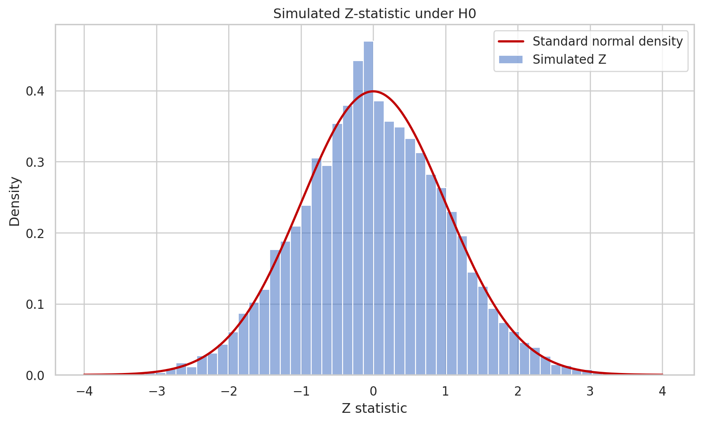

# Mathematical Foundations of A/B Testing
### Probability Models, Hypothesis Testing, and Confidence Intervals

**Course:** MT3194 – Statistical Inference  
**Instructor:** Prof. Chandrasheel Bhagwat

---

## 📌 Project Overview

This project investigates the mathematical and statistical foundations of A/B testing using an e-commerce landing page experiment.

The primary objective is to determine whether an updated landing page leads to a statistically significant improvement in user conversion rates.

We study probability models, Maximum Likelihood Estimation (MLE), two-proportion Z-tests, Likelihood Ratio Tests (LRT), confidence intervals, statistical power, and the consequences of continuous monitoring (early peeking).

## 👥 Team Members

| Name | Roll Number |
|---|---|
| Aditya Nagrale | 20231014 |
| Sahil Kumar Gupta | 20231214 |
| Guduru Vamsi Krishna | 20241113 |
| Utkarsh Kumar | 20241335 |
| Shubham Kumar Thakur | 20266604 |

## 🎯 Project Objectives

- Formulate a probability model for conversion outcomes.
- Derive Maximum Likelihood Estimators for conversion probabilities.
- Perform hypothesis testing using the two-proportion Z-test.
- Study Likelihood Ratio Testing and compare it with the Z-test.
- Estimate effect sizes and construct confidence intervals.
- Investigate statistical power and sample size requirements.
- Simulate the inflation of Type I error under repeated early checking.
- Apply the methods to a real-world e-commerce A/B testing dataset.

## 📊 Dataset

**Dataset:** E-Commerce Landing Page A/B Testing Dataset

The dataset contains approximately 290,000 user interactions.

Important variables include:

- `user_id`: Unique user identifier.
- `timestamp`: Time of interaction.
- `group`: Control or treatment.
- `landing_page`: Old or new landing page.
- `converted`: Binary conversion outcome (0 or 1).

The analysis includes checking the traffic split, identifying repeated-user anomalies, and comparing conversion rates between the two groups.

## 📐 Mathematical Framework

### 1. Probability Model

Let:

- \(p_1\) denote the conversion probability in the control group.
- \(p_2\) denote the conversion probability in the treatment group.

For individual users:

\[
X_{1i}\sim Bernoulli(p_1)
\]

\[
X_{2j}\sim Bernoulli(p_2)
\]

The total number of conversions follows:

\[
S_1\sim Binomial(n_1,p_1)
\]

\[
S_2\sim Binomial(n_2,p_2)
\]

### 2. Maximum Likelihood Estimation

The MLEs of the conversion probabilities are:

\[
\hat p_1=\frac{s_1}{n_1},
\qquad
\hat p_2=\frac{s_2}{n_2}
\]

### 3. Hypothesis Testing

We consider:

\[
H_0:p_1=p_2
\]

\[
H_1:p_1\neq p_2
\]

The pooled estimator is:

\[
\hat p=\frac{s_1+s_2}{n_1+n_2}
\]

The two-proportion Z-statistic is:

\[
Z=
\frac{\hat p_1-\hat p_2}
{\sqrt{\hat p(1-\hat p)
\left(\frac{1}{n_1}+\frac{1}{n_2}\right)}}
\]

### 4. Likelihood Ratio Test

We compare the likelihood under the null hypothesis with the unrestricted likelihood:

\[
\Lambda=
\frac{\sup_{H_0}L(p_1,p_2)}
{\sup_{p_1,p_2}L(p_1,p_2)}
\]

The resulting likelihood ratio test is compared with the two-proportion Z-test.

## 🔬 Observations and Mathematical Results

This section contains screenshots of the mathematical derivations, calculations, and observations obtained during the project.

### Observation 1: Probability Model and MLE

<!-- Attach your observation screenshot below -->


### Observation 2: Two-Proportion Z-Test

<!-- Attach your Z-test calculation screenshot below -->


### Observation 3: Likelihood Ratio Test

<!-- Attach your LRT observation screenshot below -->


## 💻 Simulation and Visualizations

We use simulations to investigate the behaviour of statistical tests and understand their theoretical properties.

### Simulation 1: Test Statistic Distribution

Comparison of the simulated test statistic with its theoretical distribution.



### Simulation 2: Statistical Power Curves

Illustration of how statistical power changes with sample size and effect size.


### Simulation 3: Early Peeking and Type I Error Inflation

Simulation of how repeatedly checking experimental results can increase the false-positive rate.


> **Note:** The image paths above are placeholders. Replace them with the actual filenames of your screenshots.

## 📈 Expected Outcomes

- Understand the relationship between probability models and hypothesis testing.
- Compare the performance and conclusions of Z-tests and likelihood ratio tests.
- Examine the role of sample size and effect size in statistical power.
- Demonstrate the risks associated with repeated hypothesis testing.
- Develop a statistically informed recommendation for the e-commerce landing page experiment.

## 🛠️ Tools and Technologies

- Python
- NumPy
- Pandas
- SciPy
- Matplotlib
- Jupyter Notebook
- LaTeX

## 📂 Repository Structure

```text
AB-Testing-Statistical-Inference/
│
├── README.md
│
├── data/
│   └── dataset.csv
│
├── notebooks/
│   ├── probability_model.ipynb
│   ├── hypothesis_testing.ipynb
│   ├── likelihood_ratio_test.ipynb
│   └── simulations.ipynb
│
├── observations/
│   ├── probability_model.pdf
│   └── statistical_observations.pdf
│
├── simulations/
│   ├── power_analysis.py
│   └── early_peeking.py
│
├── images/
│   ├── observations/
│   │   ├── mle_observation.png
│   │   ├── z_test_observation.png
│   │   └── lrt_observation.png
│   │
│   └── simulations/
│       ├── test_statistic_distribution.png
│       ├── power
